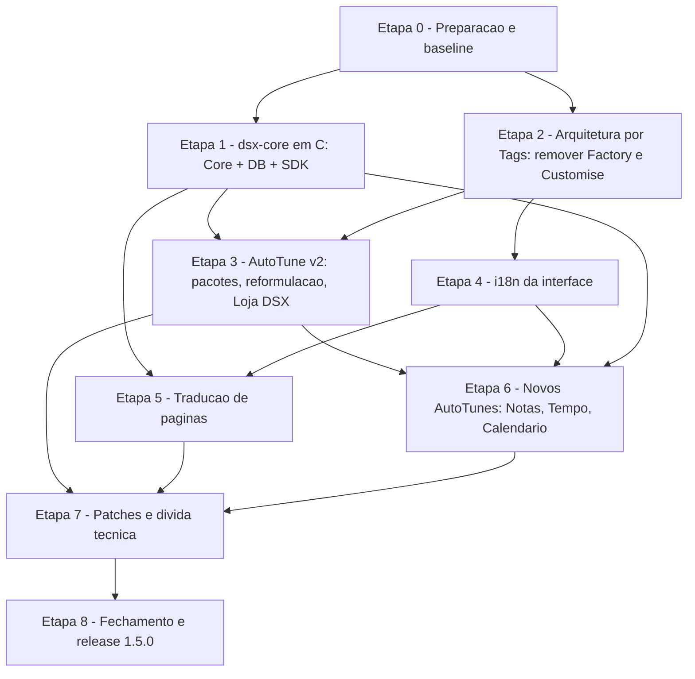

# DSX v1.5 — Planejamento de Desenvolvimento

| | |
|---|---|
| **Versão alvo** | 1.5.0 |
| **Base** | v1.4.0 Beta (04/08/2026) — `main` @ `df0a01c` |
| **Branch de trabalho** | `Versão-1.5` |
| **Status** | Planejamento (etapas serão detalhadas uma a uma em reuniões dedicadas) |
| **Documento irmão** | [`Metas de Desempenho v1.5.MD`](./Metas%20de%20Desempenho%20v1.5.MD) |

---

## 1. Objetivo da versão

A v1.5 é uma versão de **fundação**: antes de qualquer feature nova, a base do produto é refatorada para ganhar desempenho e simplicidade. Só depois entram as features.

Três frentes, nesta ordem obrigatória:

1. **Refatoração + exclusões** — Core, DB e SDK reescritos em **C** como um único daemon (`dsx-core`); remoção da camada de edição visual (Factory / Customise) em favor de uma arquitetura por **tags**.
2. **Reformulação dos AutoTunes** — engine v2 baseada em pacotes/manifesto, customização encerrada, distribuição pela **Loja DSX** no site oficial.
3. **Features** — tradução interna da interface (i18n), tradução de páginas via API interna (serviço terceiro), e novos AutoTunes: **Bloco de Notas**, **Previsão do Tempo** e **Calendário**.

---

## 2. Diagnóstico da base atual (v1.4)

Levantamento feito no código e na documentação em `Version/Docs/`, `Backend/API-DSX/Docs/` e `Backend/SDK/README.md`.

### 2.1 Processos e boot

| Item | Situação hoje | Referência |
|---|---|---|
| Processos em steady-state | **3 Node** (Electron main + API-DSX + Media SDK) + PowerShell SMTC (Windows) + `nowplaying-cli` efêmero a cada ~800 ms (macOS) | `Main/backend/ApiDsxSupervisor.js`, `MediaSdkSupervisor.js`, `Backend/SDK/src/capture/MacOSCapture.js` |
| Abertura da janela | Bloqueada até `/ready` da API — `sleep 500 ms` fixo + poll até **90 s** | `ApiDsxSupervisor._startInner`, `waitUntilReady(90000)` |
| Boot da API | `boot.js` pode copiar árvore e rodar **`npm install` em runtime** (dev/iCloud); retries com busy-wait | `Backend/API-DSX/boot.js` |
| Redis | Opcional, **nunca gerenciado pelo app**; fallback em `Map` | `Backend/API-DSX/DB/redis.js` |
| Deps nativas | `sqlite3` (node-gyp) exige `@electron/rebuild` por ABI/arquitetura no CI | `scripts/prepare-backend.js`, `.github/workflows/*.yml` |
| Porta 3333 | Liberada via `lsof`/`kill` ou `taskkill` a cada boot; sem autenticação local | `ApiDsxSupervisor._freePort3333` |

### 2.2 Renderer

| Item | Situação hoje |
|---|---|
| Scripts no boot | **139** `<script>` em `Frontend/src/index.html` + **42** carregados em série por `Tabline.js` → ~181 arquivos, sem bundler |
| Factory (AutoTune) | `UserINTer/Factory/index.js` (765 linhas) + `index.css` (349) + plugin `Clock/factory.js` (299) — carregado cedo no boot |
| Customise | `UserINTer/Tabline/idget/Customise/**` — shell, 6 componentes (radialMenu, searchPalette, smartSearch, topoGlobal, sidebarLayout, janelas) com editor + preview cada, `index.css` com 1.622 linhas |
| Chaves de storage da camada visual | `autotuneFactorySettings`, `customiseSettings`, `autotuneCustomFonts` |
| AutoTune engine | `AutoTune/index.js` (963 linhas): drag via `mousemove` no `document` por instância (sem rAF, escreve `left/top`), fusão Timer+Tasklist, Clock com `setInterval` 1 s contínuo |
| i18n | **Inexistente**. ~400 ocorrências de texto PT hardcoded (src ~125, Telas ~85, MiniTelas ~10, UserINTer ~170); `lang="pt-BR"`, `Intl` fixo em `pt-BR` |
| Tradução de página | Stub "Em breve" em `Frontend/src/CursorControll/actions/translationActions.js` |

### 2.3 Contratos que precisam ser preservados

- **Rotas HTTP** consumidas por `Frontend/src/js/userApi.js`, `historyApi.js` e `Main/downloads/DownloadTracker.js` (ver lista completa na Etapa 1).
- **Schema SQLite** em `userData/API-DSX/dsx-browser.db` (users, browser_history, downloads, favorites, password_vault, tab_groups, tab_group_tabs) — **zero perda de dados** na migração.
- **Crypto do cofre**: scrypt (N=16384, r=8, p=1; keylen 64 p/ hash, 32 p/ chave AES; salt 16 bytes hex) + AES-256-GCM (IV 12 bytes, tag 16 bytes anexada ao ciphertext, base64). Hashes e cofres existentes precisam continuar válidos byte a byte.
- **Eventos WebSocket do SDK** (`hello`, `media_change`, `media_play`, `media_pause`, `media_progress`, `media_stop`, `error`) e o **Dragon Media Format**, consumidos por `Frontend/src/js/dragon-media-bridge.js`.

---

## 3. Visão geral das etapas



Regra da versão: **Etapas 1 e 2 (refatoração e exclusões) fecham antes de qualquer feature das Etapas 4–6.** A Etapa 3 é a ponte: ela já usa o novo core (downloads/instalação de pacotes) e a nova arquitetura por tags.

Cada etapa abaixo tem: escopo, o que sai, o que entra, critérios de aceite e decisões em aberto. O detalhamento fino (design de cada módulo, telas, textos) será feito em reunião própria por etapa.

---

## Etapa 0 — Preparação e baseline

**Objetivo:** medir a v1.4 antes de mexer, e deixar toolchain de C pronta nos três sistemas.

### Entregas

- `scripts/perf/measure.js` — coleta automática das métricas listadas em [`Metas de Desempenho v1.5.MD`](./Metas%20de%20Desempenho%20v1.5.MD) (tempo até janela, tempo até `/ready`, RSS por processo via `app.getAppMetrics()`, contagem de processos, tamanho do instalador).
- Baseline registrado em `Version/Planejamento/Baseline v1.4.MD` (3 máquinas de referência: Windows x64, macOS arm64, Linux x64).
- Toolchain C: **CMake ≥ 3.24** + compilador por OS (MSVC/clang-cl no Windows, clang no macOS, gcc no Linux); job de CI `core-build` em `.github/workflows/build.yml` e `release.yml`.
- Congelar `v1.4.0-build.15` como referência de regressão.

### Critérios de aceite

- Baseline documentado com números reais (não estimativas).
- `cmake --build` de um "hello daemon" passa nos 3 runners do CI.

---

## Etapa 1 — `dsx-core`: Core, DB e SDK em C

**Decisão tomada:** daemon **standalone em C**, binário único, substituindo por completo `Backend/API-DSX` e `Backend/SDK`. O Electron passa a supervisionar **um** processo em vez de dois.

### 1.1 Arquitetura do daemon

```
Core/
├── CMakeLists.txt
├── src/
│   ├── main.c                 ← args, env, sinais, loop
│   ├── http/                  ← servidor HTTP + WebSocket (loopback), roteador, JSON
│   ├── db/                    ← SQLite embutido, migrações, repositórios
│   ├── crypto/                ← scrypt, AES-256-GCM, UUID, Ed25519 (assinatura de pacotes)
│   ├── domain/                ← users, history, favorites, downloads, vault, tabgroups
│   ├── search/                ← frecência + ranking em memória (substitui Redis)
│   ├── media/                 ← captura/controle por OS + normalização (Dragon Media Format)
│   │   ├── win/               ← SMTC (WinRT ABI)
│   │   ├── mac/               ← MediaRemote (Objective-C, mesma base do nowplaying-cli)
│   │   └── linux/             ← MPRIS via D-Bus
│   ├── store/                 ← download/verificação/instalação de pacotes (Etapa 3)
│   ├── i18n/                  ← download e cache de pacotes de idioma (Etapa 4)
│   └── translate/             ← proxy para provedor terceiro (Etapa 5)
├── third_party/               ← sqlite amalgamation, civetweb, yyjson, libsodium (vendored)
└── tests/                     ← testes unitários em C + testes de contrato
```

Bibliotecas propostas (todas C, licenças compatíveis com ISC):

| Necessidade | Biblioteca | Motivo |
|---|---|---|
| HTTP + WebSocket loopback | **civetweb** (MIT) | Um só servidor para `:3333` (REST) e `:8974` (WS) |
| JSON | **yyjson** (MIT) | Parse/serialize muito rápido; API simples |
| Banco | **SQLite amalgamation** (domínio público) | Embutido, sem node-gyp, WAL, statements preparados |
| Crypto | **libsodium** (ISC) | scrypt (`crypto_pwhash_scryptsalsa208sha256_ll`), AES-256-GCM, Ed25519, random |
| D-Bus (Linux) | `libdbus-1` ou `sd-bus` | MPRIS |

### 1.2 Contrato preservado (fase de transição)

Na v1.5 o frontend **não muda** para falar com o core: mesmas rotas, mesmos payloads (`{ success, data }` / `{ success:false, message }`), mesmas portas.

Rotas a implementar em C (contrato atual):

- `GET /health`, `GET /ready` (payload passa a `version: 4`, `engine: "dsx-core"`, mesmas `features` + novas)
- `/history`: `POST`, `GET`, `GET /search`, `GET /suggestions`, `GET /:id`, `DELETE /:id`, `DELETE`
- `/users`: `POST`, `GET`, `GET /:id`, `PATCH /:id`, `DELETE /:id`, `POST /:id/unlock`, `POST /:id/touch`
- `/favorites`: `POST`, `GET`, `DELETE /by-url`, `DELETE /:id`, `DELETE`
- `/downloads`: `POST`, `GET`, `PATCH /:id`, `DELETE /:id`, `DELETE`
- `/vault`: `POST /unlock`, `POST /lock`, `GET`, `POST`, `POST /:id/reveal`, `PATCH /:id`, `DELETE /:id`, `DELETE`
- `/tab-groups`: `GET`, `POST`, `PATCH /:id`, `DELETE /:id`, `PUT /:id/tabs`
- WebSocket `:8974` com os mesmos eventos e o comando de controle (`play_pause`, `next`, `previous`, `volume_up`, `volume_down`).

Melhorias de contrato permitidas (aditivas): token de sessão local (gerado pelo main, passado por env ao daemon e por header no renderer) para impedir que outros apps locais usem a API; `/ready` deixa de precisar do hack de matar a porta.

### 1.3 Banco de dados

- Mesmo schema; adicionar tabela `schema_version` e migrações incrementais em C.
- Abrir o `dsx-browser.db` existente em `userData/API-DSX/` **in place** (WAL habilitado, `foreign_keys=ON`), sem cópia de seed.
- Statements preparados cacheados; índices atuais mantidos.
- Redis eliminado: cache de sessão e ranking (`smart-search:rank:{userId}`) viram estruturas em memória no daemon (hash map + heap/sorted array) com persistência de frecência no SQLite.

### 1.4 Crypto (compatibilidade obrigatória)

- scrypt com **exatamente** N=16384, r=8, p=1, salt hex de 16 bytes, keylen 64 (hash) / 32 (chave).
- AES-256-GCM com IV de 12 bytes e tag de 16 bytes concatenada ao final do ciphertext, tudo base64.
- Suíte de vetores de teste gerada a partir do `Backend/API-DSX/Utils/crypto.js` atual **antes** de apagar o código Node.
- Modo device (`dsx-device:{userId}`) e sessões de unlock (TTL 12 h) reproduzidos.

### 1.5 SDK de mídia em C

| OS | Captura | Controle | Observação |
|---|---|---|---|
| Windows | SMTC via WinRT ABI (`GlobalSystemMediaTransportControlsSessionManager`) | mesma sessão | **Risco**: WinRT em C puro é verboso; aceitar um único arquivo shim `.cpp` se necessário (decisão em aberto) |
| macOS | MediaRemote.framework via `dlopen` (Objective-C, mesma base do `nowplaying-cli`) | MediaRemote + volume via CoreAudio | Elimina o spawn de CLI a cada 800 ms |
| Linux | MPRIS por D-Bus (listener de sinais, sem polling) | MPRIS + PulseAudio/PipeWire | Elimina `pactl` spawnado |

Eventos entregues por push (sem poll de 800 ms); `media_progress` calculado por relógio local entre eventos.

### 1.6 Electron main

- Novo `Main/backend/CoreSupervisor.js` substitui `ApiDsxSupervisor.js` + `MediaSdkSupervisor.js`: spawn de `resources/bin/<platform>-<arch>/dsx-core`, probe de `/ready`, auto-restart com backoff, parada em `before-quit`.
- `PathResolver.js` reduzido a resolver o binário.
- Remover a espera longa: alvo de `/ready` em dezenas de ms; a janela pode ser criada em paralelo e o renderer já lida com `waitForApi`.
- Contratos `IProcessSupervisor` / `IApiProbe` mantidos; `IBackendPathResolver` simplificado. Atualizar `Version/Docs/MainProcess.md`.

### 1.7 Build e empacotamento

- `scripts/prepare-core.js` (substitui `prepare-backend.js` e `fetch-nowplaying-cli.js`): compila via CMake (ou baixa artefato do CI) e copia para `resources/bin/`.
- `package.json` → `extraResources` passa a ser só o binário; remover `@electron/rebuild`, `png2icons` continua; `build.files` sem `!Backend/**`.
- CI: matriz já existe (win/mac/linux); adicionar step CMake e cache de `third_party`. No macOS, o binário precisa entrar na assinatura/notarização do bundle (electron-builder assina `Contents/Resources` — validar).

### 1.8 Estratégia de migração e testes

1. Suíte de **testes de contrato** em JS (`Core/tests/contract/*.test.js`) rodando contra a API Node atual → vira o "golden".
2. Implementar o daemon rota a rota; a mesma suíte roda contra o C.
3. Flag de dev `DSX_CORE_ENGINE=node|c` no `createMainApp` durante a transição.
4. Quando 100 % da suíte passar nos 3 OS e o SDK reproduzir os eventos, **apagar** o Node.

### O que sai nesta etapa

- `Backend/API-DSX/**` (código, `node_modules`, `boot.js`, `Docs/` migradas para `Version/Docs/Core/`)
- `Backend/SDK/**` (inclui `scripts/windows-smtc-control.ps1`, `bin/`)
- `Backend/server.js`, `Backend/package.json` (stub porta 5000 sem uso)
- `Main/backend/ApiDsxSupervisor.js`, `MediaSdkSupervisor.js`
- `scripts/prepare-backend.js`, `scripts/fetch-nowplaying-cli.js`, `scripts/before-pack.js` (ou reescrito para o core)
- Dependências: `sqlite3`, `express`, `cors`, `dotenv`, `redis`, `nodemon`, `ws`, `dbus-next`, `@coooookies/windows-smtc-monitor`, `@electron/rebuild`
- Toda referência a Redis (env `REDIS_*`)

### Critérios de aceite

- 100 % dos testes de contrato passando nos 3 OS.
- Cofres e senhas criados na v1.4 abrem na v1.5 sem reentrada.
- Zero processos Node filhos; zero spawn periódico de CLI/PowerShell.
- Metas da seção "Core" em [`Metas de Desempenho v1.5.MD`](./Metas%20de%20Desempenho%20v1.5.MD) atingidas.

### Decisões em aberto

- Shim C++ para WinRT no Windows: permitir ou insistir em C puro via `RoGetActivationFactory`?
- Loopback TCP (compatível com o frontend atual) vs. Unix socket / named pipe (mais rápido/seguro, exige adaptador no preload). Proposta: TCP + token na 1.5; socket na 1.6.
- Distribuir `dsx-core` também como CLI standalone (`dsx-core --serve`)? Útil para depuração e para o site.

---

## Etapa 2 — Arquitetura por Tags: fim do Factory e do Customise

**Decisão tomada:** Factory (editor visual dos AutoTunes) e Customise (editor dos objetos da interface) deixam de existir como **interface**. Toda a personalização passa a ser **declarativa, por tags**, definida no próprio componente/pacote. Não há mais UI que altere esses valores em runtime.

> Este tema será destrinchado em reunião própria. Abaixo, o recorte mínimo para ordenar as exclusões e não quebrar o app.

### 2.1 Conceito (rascunho a validar)

- **Tag** = atributo `data-dsx-*` no markup do componente ou campo `tags` no manifesto do pacote.
- Um resolvedor único (`Frontend/src/core/Tags.js`) lê as tags **uma vez** no mount e converte em CSS custom properties (`--dsx-accent`, `--dsx-radius`, `--dsx-bg-alpha`, …) no escopo do elemento. Sem observers permanentes, sem `<style>` injetado por chave, sem `style` inline por slider.
- Presets do produto (Topo Global, Radial, Search Palette, Buscadores, Barra Lateral, Janelas) passam a ser um arquivo estático `Frontend/src/core/dsx.ui.json` versionado no repositório — o usuário não edita.
- Variações visuais de um AutoTune vêm do **pacote** baixado na Loja (Etapa 3), não de um editor local.

Exemplo do formato pretendido:

```html
<div class="floating-widget"
     data-dsx-widget="clock"
     data-dsx-preset="neon"
     data-dsx-accent="#7a8cff"
     data-dsx-radius="14"
     data-dsx-bg-alpha="0.85">
```

### 2.2 O que sai

| Caminho | Linhas | Substituído por |
|---|---|---|
| `UserINTer/Factory/index.js` + `index.css` | 765 + 349 | `Frontend/src/core/Tags.js` |
| `UserINTer/Tabline/idget/AutoTune/Clock/factory.js` | 299 | presets no manifesto do Clock |
| `UserINTer/Tabline/idget/Customise/core/shell.js`, `catalog.html`, `index.css` | ~1.900 | — |
| `UserINTer/Tabline/idget/Customise/components/*/editor.js` e `preview.js` (6 componentes) | ~1.500 | valores fixos em `dsx.ui.json` |
| `UserINTer/Tabline/idget/Customise/factory/**`, `adapters/runtimeAdapter.js` | — | — |
| Botões ⚙ e atributos `data-open-factory*` em `AutoTune/catalog.html` | — | — |
| Chaves de storage `autotuneFactorySettings`, `customiseSettings`, `autotuneCustomFonts` | — | migração de limpeza no primeiro boot |
| Eventos `customise:settings-changed`, `customise:reloaded` | — | evento único `tags:applied` |
| `Version/Docs/Factory.md`, `Customise.md`, `NewComponet.md` | — | `Version/Docs/Tags.md` + `AutoTunePackage.md` |
| Entrada "Customise" no flyout da Tabline (`Tabline.html` / `Tabline.js`) | — | — |

### 2.3 O que permanece (como dado, sem editor)

- `ChromeLayoutSettings` (`dragonsx.chrome.layout`), `SidebarNS.Store` (`sidebar.layout`), `JanelasNS.Store` (`dragonsx.janelas`) continuam existindo como **stores lidos pelo runtime**, mas passam a ser alimentados por `dsx.ui.json` + tags. Migração: ler valores legados uma vez e descartar as chaves.
- `RadialMenu`, `SearchPalette`, `SmartSearch`, `ChromeLayout` continuam consumindo variáveis CSS — só troca a origem (Tags em vez de Customise).

### 2.4 Ordem segura de remoção

1. Criar `Tags.js` + `dsx.ui.json` com os **defaults atuais** de cada componente (extraídos de `components/*/defaults.js`).
2. Apontar consumidores (`RadialMenu`, `SearchPalette`, `SmartSearch`, `ChromeLayout`, `Sidebar`, `Janelas`) para Tags; validar visualmente que nada mudou.
3. Remover Customise (shell, editores, catálogo, CSS, entrada na Tabline).
4. Remover Factory e o plugin do Clock; AutoTune engine deixa de chamar `applyPersistedToElement`.
5. Migração de storage no boot: apagar chaves legadas.
6. Atualizar `Frontend/src/core/manifest.css`, `Tabline.js` (`WIDGET_SCRIPTS`), `Shell.js` (não montar mais `Customise/catalog.html`), `app.js` (referências a `window.Customise` / `window.AutoTuneFactory`), `shortcuts/overlays/radial-menu/index.js`, `Tabline/core/dispatcher.js`.
7. Reescrever docs.

### Critérios de aceite

- App abre sem nenhuma referência a `AutoTuneFactory`, `Customise`, `CustomiseNS`.
- Aparência padrão idêntica à v1.4 (comparação de screenshots das telas principais).
- Redução mensurável de JS/CSS carregado no boot (meta em [`Metas de Desempenho v1.5.MD`](./Metas%20de%20Desempenho%20v1.5.MD)).

### Decisões em aberto

- Nome/gramática final das tags (`data-dsx-*` vs. namespace único `data-tags="accent:#…;radius:14"`).
- Quais preferências **funcionais** (não visuais) sobrevivem em uma tela de Configurações mínima (ex.: posição do Music, ordem dos botões do topo, layouts de Janelas) — ou se tudo vira tag.
- Fusão Timer+Tasklist ("focusflow"): manter, virar pacote próprio ou remover.

---

## Etapa 3 — AutoTune v2: pacotes, reformulação e Loja DSX

**Objetivo:** todo AutoTune vira um **pacote** com manifesto; os cinco atuais são reescritos nesse formato; customização encerrada (sem ⚙); novos AutoTunes só via Loja DSX no site oficial.

### 3.1 Formato de pacote (`.dsxa`)

```
<id>/
├── autotune.json     ← manifesto
├── index.js          ← registra window.AutoTuneWidgets[id]
├── index.css
├── i18n/
│   ├── pt-BR.json
│   └── en-US.json
└── assets/
```

```json
{
  "id": "clock",
  "name": { "pt-BR": "Relógio", "en-US": "Clock" },
  "version": "2.0.0",
  "minApp": "1.5.0",
  "author": "DSX",
  "entry": "index.js",
  "style": "index.css",
  "size": { "defaultWidth": 240, "defaultHeight": 140, "minWidth": 160, "minHeight": 100 },
  "persistent": false,
  "mediaGated": false,
  "tags": { "accent": "#7a8cff", "radius": 14, "bgAlpha": 0.85, "preset": "neon" },
  "permissions": ["network:weather", "core:notes"],
  "signature": "ed25519:base64"
}
```

- Pacotes **built-in** ficam em `UserINTer/AutoTunes/<id>/` (renomeando `UserINTer/Tabline/idget/AutoTune/<Nome>/`).
- Pacotes instalados ficam em `userData/autotunes/<id>/`.
- Assinatura Ed25519 verificada pelo `dsx-core` (chave pública embutida) antes de carregar.

### 3.2 Engine v2 (`AutoTune/index.js` reescrito)

- Registro dinâmico a partir dos manifestos (fim de `TYPES`/`TITLES`/`emptyState()` fixos).
- Drag/resize: um único listener global de `pointermove` + `requestAnimationFrame`, movimento por `transform: translate3d` durante o arraste e commit em `left/top` no `pointerup`; `ResizeObserver` para clamp; persistência com debounce.
- Widgets pausam trabalho quando `PerfIdle` marca janela oculta/idle (ex.: Clock alinha ao segundo e para em background).
- Catálogo gerado do registro (toggle on/off + botão "Loja" + "Remover" para pacotes instalados).
- Persistência de posição continua em `settingsAUTO` (compatível), estendida para ids dinâmicos.

### 3.3 Reformulação dos AutoTunes existentes

| AutoTune | Mudança |
|---|---|
| Timer | vira pacote; sem `CUSTOM_CONFIG`; rAF só quando rodando (já é) |
| Share | vira pacote; integra `SmartSearch` como hoje |
| Tasklist | vira pacote; store próprio mantido (`autotuneTasklistData`) |
| Music (minimal) | vira pacote persistente + mediaGated; posições (left/right/bottom) passam a tag/preferência funcional |
| Clock | vira pacote; remoção do plugin Factory; presets de layout viram `tags.preset` |

### 3.4 Loja DSX (contrato com o site)

O site ([dragonsx.com.br](https://dragonsx.com.br)) está fora deste repositório; aqui define-se o **contrato**:

- `GET https://dragonsx.com.br/api/store/autotunes?app=1.5.0&lang=pt-BR` → índice JSON (id, nome, versão, descrição, capa, tamanho, hash, url do `.dsxa`).
- `GET <url>.dsxa` → zip assinado.
- No app: `dsx-core` expõe `GET /store/index`, `POST /store/install {id}`, `DELETE /store/:id`, `GET /store/installed`; faz download, verifica hash + assinatura, extrai em `userData/autotunes/`.
- Renderer: tela `Frontend/Telas/Loja/` (lista, instalar, remover, atualizar) — sem editor.
- Documento `Version/Docs/Store.md`.

### Critérios de aceite

- Os 5 AutoTunes atuais funcionam como pacotes built-in com posição restaurada da v1.4.
- Instalar/remover um pacote de teste pela Loja sem reiniciar o app.
- Pacote com assinatura inválida é recusado.

### Decisões em aberto

- Sandbox dos pacotes de terceiros (rodam no renderer principal hoje). Opções: confiar só em pacotes assinados pela DSX na 1.5; iframe/`<webview>` isolado na 1.6.
- Política de atualização automática de pacotes.

---

## Etapa 4 — Tradução interna da interface (i18n)

**Objetivo:** catalogar **todos** os textos do navegador e permitir troca de idioma com download do pacote correto.

### 4.1 Catálogo

- Formato: `Frontend/i18n/<lang>.json` com chaves hierárquicas `area.componente.chave` (ex.: `tabs.groups.newGroup`, `telas.downloads.empty`).
- Fonte de verdade: `pt-BR.json`; `en-US.json` é o primeiro idioma alvo. Ambos **embutidos** no app; demais idiomas baixados.
- Escopo do inventário (~400 ocorrências): `Frontend/src/**` (HTML, `innerHTML`, `textContent`, `placeholder`, `title`, `aria-label`), `Frontend/Telas/**`, `Frontend/MiniTelas/**`, `UserINTer/**` (Tabline, AutoTunes, Wallpaper, Tema, Donate), `Main/**` (menu macOS, diálogos), `MediaDrm` (mensagens), strings de permissão em `package.json` (`extendInfo`), páginas de erro.
- Datas/números: trocar `pt-BR` fixo (`Historico-Navegação.js`, `Clock/config.js`) por `Intl` com o locale ativo.

### 4.2 Mecanismo

- `Frontend/src/core/I18n.js`: `I18n.t(key, params)`, `I18n.setLocale(lang)`, `I18n.format.date/number`; aplica `data-i18n="key"` e `data-i18n-attr="title:key;aria-label:key"` no mount e em `I18n.apply(rootEl)` para fragmentos carregados por `fetch`.
- Evento `i18n:changed` — módulos re-renderizam textos dinâmicos; `document.documentElement.lang` acompanha.
- Preferência `dsx.locale` (por usuário, via `UserStorage`); default = idioma do SO se houver pacote, senão `pt-BR`.
- Pacotes de idioma: `dsx-core` expõe `GET /i18n/available`, `POST /i18n/install {lang}` (download de `https://dragonsx.com.br/i18n/<lang>.json`, cache em `userData/i18n/`).
- Lint: `scripts/i18n-check.js` falha o CI se houver chave usada sem tradução em `pt-BR`/`en-US` ou texto literal em atributos monitorados.

### Critérios de aceite

- `pt-BR` e `en-US` 100 % cobertos; troca de idioma sem reiniciar.
- Nenhum texto hardcoded remanescente (lint verde).
- AutoTunes built-in usam `i18n/` do próprio pacote.

---

## Etapa 5 — Tradução de páginas (API interna → serviço terceiro)

**Decisão tomada:** a tradução usa um **serviço terceiro**; o app conversa apenas com a API interna (`dsx-core`), que faz o proxy.

### 5.1 Backend (C)

- `POST /translate` `{ segments: [{id, text}], from: "auto"|lang, to: lang }` → `{ segments: [{id, text}], provider, detected }`.
- Adapter de provedor pluggável em `Core/src/translate/` (candidatos: DeepL, Google Cloud Translation, Azure Translator, LibreTranslate). Escolha do provedor e do modelo de cobrança: **em aberto**.
- Cache SQLite `translation_cache (hash, from, to, text, created_at)`; lote máximo por requisição (≈100 segmentos / 5.000 caracteres).
- Chave do provedor **não** embarcada no cliente: proxy em `api.dragonsx.com.br/translate` (chave no servidor) ou chave do próprio usuário guardada no cofre — **decisão em aberto**.

### 5.2 Renderer

- Script injetado no `<webview>` (mesmo padrão de `Passwords/detection/formDetector.preload.js`): coleta text nodes visíveis (ignora `script/style/code/pre/input/textarea`, `translate="no"`), gera segmentos, aplica substituições preservando o DOM, observa mutações para conteúdo dinâmico, permite "restaurar original".
- Ponte: renderer → IPC (`translate:page`) → main → `dsx-core`.
- UI: ação "Traduzir" real em `CursorControll/actions/translationActions.js`; oferta automática na barra quando `<html lang>` ≠ idioma da UI; item "Sempre traduzir <idioma>".

### Critérios de aceite

- Página de ~3.000 palavras traduzida dentro da meta de tempo; cache hit sem rede.
- Formulários e inputs intactos após tradução; restaurar original funciona.

---

## Etapa 6 — Novos AutoTunes: Bloco de Notas, Previsão do Tempo, Calendário

Todos entregues como **pacotes built-in** no formato da Etapa 3, com `i18n/` próprio e dados no `dsx-core`.

| AutoTune | Dados | Rotas no core | Notas |
|---|---|---|---|
| **Bloco de Notas** | tabela `notes (id, user_id, title, body, updated_at)` | `GET/POST/PATCH/DELETE /notes` | markdown leve, autosave com debounce, busca; múltiplas notas por usuário |
| **Previsão do Tempo** | cache em memória + `weather_cache` | `GET /weather?lat&lon&units` | provedor **Open-Meteo** (sem chave); localização manual ou por IP; cache 15 min; ícones próprios |
| **Calendário** | `calendar_events (id, user_id, title, start, end, all_day, color, notes)` | `GET/POST/PATCH/DELETE /calendar/events` | visão mês/semana, eventos locais, import `.ics`; sem sincronização externa na 1.5 |

Critérios de aceite: cada um funciona offline (exceto refresh do tempo), respeita `PerfIdle`, e passa no lint de i18n.

---

## Etapa 7 — Patches e dívida técnica ("Pachs")

Itens encontrados no levantamento, para entrar junto da versão:

- Remover `Backend/server.js` (stub porta 5000) — já coberto pela Etapa 1.
- `resources/release-info.json` ainda em `1.2.4` — sincronizar com `package.json` via script.
- `Version/Docs/Frontend/Inicial.MD` referencia `ChecklistRegressao.MD` e `TaskPlanejamento.MD` inexistentes — recriar checklist de regressão para a 1.5.
- `Tabline.js` carrega 42 scripts **em série** (`await` em loop) — carregar em paralelo ou empacotar.
- **Bundling do renderer** (opcional, alto impacto): substituir os 139 `<script>` por um bundle único (esbuild, sem transpilar) mantendo a ordem atual — decisão em aberto por impacto no fluxo de desenvolvimento.
- `Factory` deixa listener global de `Escape` vivo — desaparece com a Etapa 2.
- `Clock` com `setInterval` 1 s mesmo com janela oculta — resolvido na engine v2.
- Padronizar títulos de janela e `lang` dinâmico (Etapa 4).
- Revisar `SessionHardener` / permissões para as novas chamadas de rede (weather, translate, store).

---

## Etapa 8 — Fechamento e release 1.5.0

- Documentação: novos `Version/Docs/Core.md`, `Tags.md`, `AutoTunePackage.md`, `Store.md`, `I18n.md`, `Translate.md`; atualizar `MainProcess.md`, `Autotune.md`, `BuscaInteligente.md`, `Frontend/*.MD`; apagar `Factory.md`, `Customise.md`, `NewComponet.md`.
- `Version/Lançamento/Log v1.5.MD`, `README.md` (badges: C/CMake no lugar de Express/WebSocket), `package.json` → `1.5.0`, `release-info.json`.
- CI verde nos 3 OS com binário assinado (mac notarizado).
- Checklist de regressão manual executado; metas de desempenho atingidas e registradas em `Version/Planejamento/Resultado v1.5.MD`.

---

## 4. Resumo do que será excluído

| Área | Itens |
|---|---|
| Backend Node | `Backend/API-DSX/**`, `Backend/SDK/**`, `Backend/server.js`, `Backend/package*.json` |
| Main | `ApiDsxSupervisor.js`, `MediaSdkSupervisor.js` (→ `CoreSupervisor.js`) |
| Scripts | `prepare-backend.js`, `fetch-nowplaying-cli.js`, `before-pack.js` (reescrito) |
| Dependências | `sqlite3`, `express`, `cors`, `dotenv`, `redis`, `nodemon`, `ws`, `dbus-next`, `@coooookies/windows-smtc-monitor`, `@electron/rebuild` |
| Interface | `UserINTer/Factory/**`, `Customise/**` (shell, editores, previews, catálogo, CSS), `Clock/factory.js`, botões ⚙ do catálogo AutoTune, entrada Customise na Tabline |
| Storage | `autotuneFactorySettings`, `customiseSettings`, `autotuneCustomFonts`, `autotuneCosmetics` (legado) |
| Docs | `Factory.md`, `Customise.md`, `NewComponet.md`, `Backend/API-DSX/Docs/*` (migrados), `Backend/SDK/README.md` (migrado) |
| Infra | Todo suporte a Redis; `npm install` em runtime; hack de liberar porta 3333 |

---

## 5. Riscos principais

| Risco | Mitigação |
|---|---|
| Incompatibilidade de crypto → perda de cofres | Vetores de teste gerados do Node antes da remoção; teste de abertura de DB real da v1.4 |
| WinRT/MediaRemote em C | Prototipar captura por OS na Etapa 0/1 antes do resto do daemon; aceitar shim mínimo se necessário |
| Assinatura/notarização do binário no macOS | Validar no primeiro build de CI da Etapa 1 |
| Remoção do Customise mudar a aparência | Extrair defaults atuais para `dsx.ui.json` antes de apagar editores; comparação visual |
| Escopo de i18n subestimado | Lint automático + inventário por área antes de começar |
| Custo/limites do provedor de tradução | Cache agressivo, lote, e decisão explícita sobre proxy vs. chave do usuário |

---

## 6. Próximos passos imediatos

1. Aprovar este plano e a ordem das etapas.
2. Executar a Etapa 0 (baseline + toolchain) — pré-requisito de tudo.
3. Reunião de detalhamento da Etapa 1 (dsx-core): fechar bibliotecas, layout de `Core/`, e os protótipos de captura de mídia por OS.
4. Reunião de detalhamento da Etapa 2 (Tags): gramática das tags e o que vira preferência funcional.

---

<p align="center">
  <sub>DSX 1.5 — Planejamento · dragonsx.com.br — © 2026 Pedro Henrique Carneichuk Rosa</sub>
</p>
